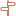
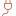
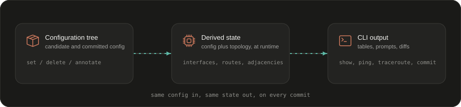
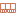

<div align="center">



<h1>SharkLab Studio</h1>

<p><b>A JNCIA-Junos practice lab that runs entirely in your browser.</b></p>

<p>No Junos image, no VM, no licenses. Drag a topology onto the canvas, start the nodes, and work<br>
telnet-style consoles into simulated Junos devices that boot, route, switch and commit like the real thing.</p>

<p>
  <a href="https://jncia-junos-lab.vercel.app"></a>
  
  
  
  
</p>

<p>
  <a href="https://jncia-junos-lab.vercel.app"><b>Live demo</b></a>
  &nbsp;·&nbsp;
  <a href="Desktop/jnciapracticelabs/docs/needs.html">Requirement reference</a>
  &nbsp;·&nbsp;
  <a href="Desktop/jnciapracticelabs/docs/features.html">Feature coverage</a>
  &nbsp;·&nbsp;
  <a href="#run-it-locally">Run it locally</a>
</p>

</div>

## Why it feels real

The simulation is not a transcript. Every device holds a real hierarchical configuration tree, and the
operational state you see (`show route`, `show ospf neighbor`, `show arp`, interface counters, ping and
traceroute results) is derived from that configuration plus the cabling at runtime, the same way Junos
derives state after a commit.

That means devices you add are not decorations. Drop a QFX5100 or a fourth router and it joins the
world: it gets real ports, speaks OSPF with its neighbors, learns MAC addresses, and answers ping
across links you drew yourself. The default lab stays exactly as it was, because it is just another
input to the same engine.

## What is inside

| | Capability | What it does |
|:--:|---|---|
|  | **Junos consoles** | Boot sequence and `login:` prompt, root shell, operational and configuration modes, `root@R1>` and `[edit] root@R1#` prompts, history, Tab and `?` completion with descriptions, unique prefix matching (`sh ver`), pipes (`match`, `except`, `count`), and `---(more)---` paging |
|  | **Derived state** | Interfaces with SNMP ifIndex, route tables with protocol tags and preferences (`Direct/0`, `Local/8`, `Static/5`, `OSPF/10`), OSPF adjacencies, LSAs and SPF routes, ARP, LLDP, MAC learning, RSTP roles |
|  | **Commit workflow** | Candidate configuration, `show \| compare` diffs with `+` and `-` markers, `commit check`, `commit comment`, `commit confirmed` auto-rollback, `rollback [n]`, `activate`, `deactivate`, `rename`, `copy`, `annotate` |
|  | **Sessions and peering** | `ssh` or `telnet` from one console into another device, reciprocal BGP session states, end to end ping and traceroute with the real next hop chain |
|  | **Workbench** | Device palette, zoomable dark canvas, link tools with interface labels, annotations (text, rectangle, ellipse, line), topology tree, console manager, status bar |
|  | **Security practice** | SRX zone pairs, policies, source NAT and a two node chassis cluster, all through the same CLI surface |
|  | **Host consoles** | VPCS-style end devices with their own prompt, address, gateway and host-side ping and trace |
|  | **Projects** | Create, save, open, import and export projects, snapshots, six quick lab presets, all persisted in localStorage and fully usable offline |

## Devices

Twenty-four devices across five families, each with its own glyph in the palette and in the tree.

| Routers (6) | Switches (6) | Endpoints (6) | Security (3) |
|:--|:--|:--|:--|
|  vSRX |  EX Switch |  VPCS |  SRX300 |
|  vMX |  EX4300 |  Ubuntu |  SRX340 |
|  vPTX |  EX2300 |  Alpine |  vSRX HA |
|  MX240 |  EX3400 |  Windows 11 | |
|  ACX1100 |  QFX5100 |  Linux server | |
|  Junos router |  Virtual chassis |  Docker host | |

**Link tools:**  Ethernet,
 console cable,
 serial.

Switches are switches, not routers with a different label: an EX or QFX from the palette answers
`show ethernet-switching table`, `show vlans`, `show spanning-tree bridge` and the IRB views, with a
MAC table that follows the hosts you attach.

## The default lab

The **JNCIA Basic Routing** preset, six devices, ready in one click.

| Device | Model | Role | Key addresses |
|:--|:--|:--|:--|
|  R1 | MX240 | Edge router, static default toward R2, OSPF and iBGP speaker | lo0 1.1.1.1/32, ge-0/0/0 in 10.0.12.0/30, fxp0 mgmt 192.168.1.x |
|  R2 | MX240 | Core router between R1 and R3 | lo0 2.2.2.2/32, links in 10.0.12.0/30 and 10.0.23.0/30 |
|  R3 | MX240 | Edge router with a discard static instead of a default route | lo0 3.3.3.3/32, link in 10.0.23.0/30 |
|  SW1 | EX4300-24T | Access switch, staff and guest VLANs, RSTP, IRB inter-VLAN routing | irb.10 10.0.3.2/24, irb.20 10.1.1.2/24, uplink to R1 |
|  Host-A | VPCS | End device in the staff VLAN | 10.0.3.20 |
|  Host-B | VPCS | End device in the guest VLAN | 10.1.1.20 |

Routed links are R1 to R2 on the ge-0/0/0 pair in 10.0.12.0/30 and R2 to R3 on ge-0/0/0 in
10.0.23.0/30. R1 to SW1 is a layer 2 link, and both hosts sit behind SW1 on different VLANs, which is
what makes cross-VLAN routing through `irb` worth practicing.

## Try this flow

```
login: root
root@R1:~ # cli
root@R1> show version
root@R1> show interfaces terse
root@R1> show route
root@R1> show ospf neighbor
root@R1> ping 2.2.2.2
root@R1> traceroute 3.3.3.3
root@R1> ssh root@3.3.3.3
root@R1> configure
root@R1# set system host-name R1-LAB
root@R1# show | compare
root@R1# commit check
root@R1# commit
root@R1# show configuration | display set
root@R1# exit
```

Console output adapts to the device family: the EX4300 answers `show vlans`, `show spanning-tree
bridge` and the ethernet-switching table, the MX240s answer MX chassis, routing and BGP views, and the
SRX family answers zones, policies and NAT.

## Run it locally

```bash
git clone https://github.com/sarveshkamdi7-collab/SHARKSJunosLabspractice
cd SHARKSJunosLabspractice/Desktop/jnciapracticelabs
npm start
```

Then open <http://localhost:3000>.

| Option | How |
|:--|:--|
| Node version | 14 or newer, nothing else |
| Different port | `PORT=8080 npm start` |
| Windows | double-click `START-WINDOWS.bat` |
| macOS and Linux | `./START-MAC-LINUX.sh` |
| Server | `server/server.js`, dependency free, MIME types, `index.html` fallback, path traversal protection |

## Tests

<p align="center"></p>

```bash
cd Desktop/jnciapracticelabs
npm test
```

| Probe | Command | What it covers | Result |
|:--|:--|:--|--:|
| Engine suite | `npm test` | Loads the engine into a Node VM and checks prompts, session flow, config semantics, derived state, `show \| compare`, `commit check`, `commit confirmed` | 13 / 13 |
| Smoke run | `npm run test:smoke` | Boot to login, CLI entry, routing, switching, ping and trace across the default lab | all pass |
| Command coverage | `npm run test:coverage` | Every command named in the reference guide must dispatch without an unknown or syntax error | 68 / 68 |
| BGP probe | `npm run test:bgp` | EBGP preset configs produce the expected session, route and policy output on both peers | 0 failures |

All four run without a browser and exit non-zero on failure, so they work as a pre-commit gate.

## How the engine works

<p align="center"></p>

| Layer | Responsibility | File |
|:--|:--|:--|
|  Configuration tree | `set`, `delete`, `deactivate`, `annotate`, brace and set-notation rendering, `show \| compare` diffs | `public/js/junos/db.js` |
|  Runtime derivation | Committed config plus topology becomes interfaces, subnets, routes, OSPF LSAs and adjacencies, ARP, LLDP, MAC table, STP, BGP sessions, ping and traceroute | `public/js/junos/derive.js` |
|  CLI machine | Operational and configuration grammar, prefix matching with completions, pipes, session switching, commit lifecycle | `public/js/junos/machine.js` |
|  Inventory | Device specs, baseline configs as `set` statements, topology graph, host definitions | `public/js/junos/model.js` |
|  Command surface | Which commands each device family answers, and in which mode | `public/js/junos/schema.js` |
|  Utilities | IPv4 math, stable MAC generation, Junos time formats, safe column padding | `public/js/junos/util.js` |

`docs/needs.html` pins the exact sample output for every view, and `docs/features.html` tracks coverage
against the requirement register (R-01 through R-16). When a behavior changes, pin it there first, then
in the tests. The command surface keeps growing, so open a console and use `?` at any level to see what
that device answers today.

## Project layout

```
SHARKSJunosLabspractice/
  assets/                          README artwork, SVG icons and animated diagrams
  Desktop/jnciapracticelabs/
    public/
      index.html                   single page shell and the SVG icon sprite
      css/app.css                  design tokens, layout, panels, palette
      fonts/                       Libron and Geist Mono
      js/junos/                    engine: util, db, model, derive, schema, machine
      js/ui/                       shell: core, interactions, console, terminal, modals, boot, vpcs
    server/server.js               zero dependency static server
    tests/                         run-tests.js plus the smoke, coverage and BGP probes
    docs/                          requirement reference and feature coverage
  DESIGN.md                        palette, type and motion rules
  vercel.json                      deploy configuration
```

## Deploy

`vercel.json` points Vercel at `Desktop/jnciapracticelabs/public`, so there is no build step:

```bash
npx vercel deploy --prod
```

For automatic deploys on push, connect the repository to a Vercel project once from the dashboard.
The site is static, and the only state it keeps lives in your browser.

## Contributing

This is a student collaboration project built for JNCIA-Junos practice lectures. Behavior should be
pinned through the samples in `docs/needs.html` first, then covered by the probes, and every change
should keep the lab offline capable and free of runtime dependencies. Run all four gates before
opening a pull request.

## Credits

Device glyphs in the palette, the tree, the console manager and this README come from
[Bootstrap Icons](https://github.com/twbs/icons) (MIT). The canvas node art, favicon and the animated
diagrams in `assets/` are drawn for this project.
